+++
title = "Inktober 2026"
description = "[Inktober 2026](https://inktober.com/)"
date = 2026-11-04
[taxonomies]
tags = ["Drawing"]
[extra]
thumbnail = "grbt_day10_mystical.webp"
+++

{{ 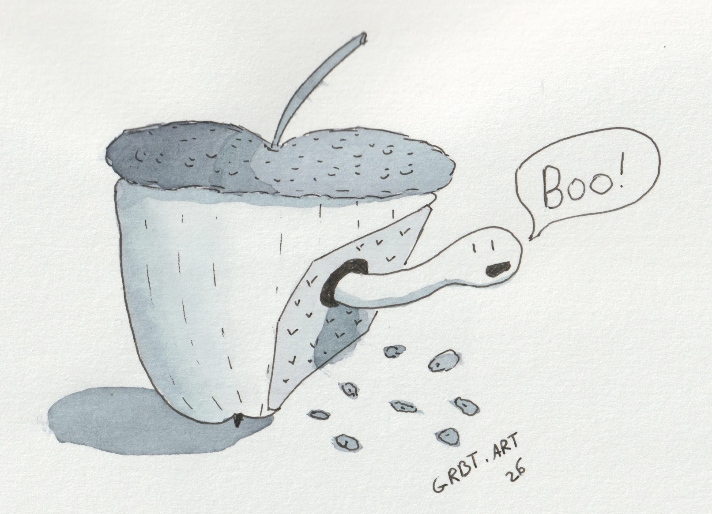 }}
{{ 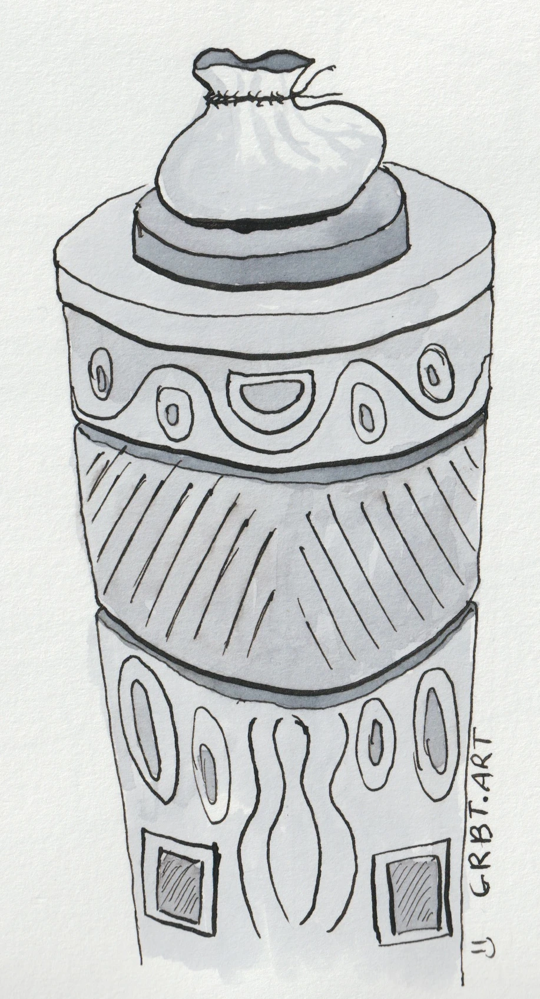 }}
{{ 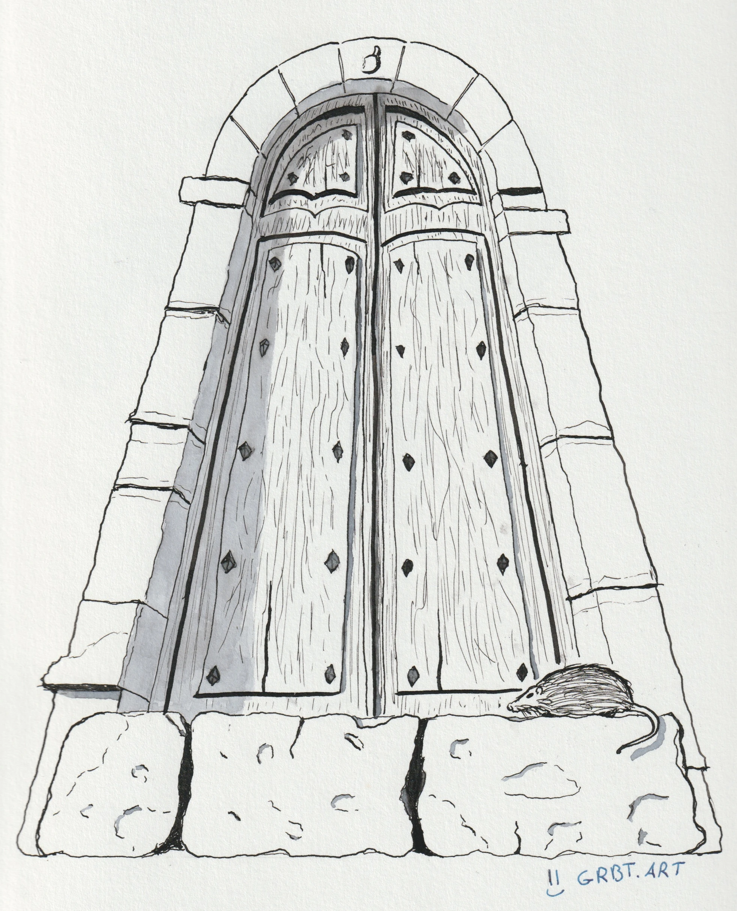 }}
{{ 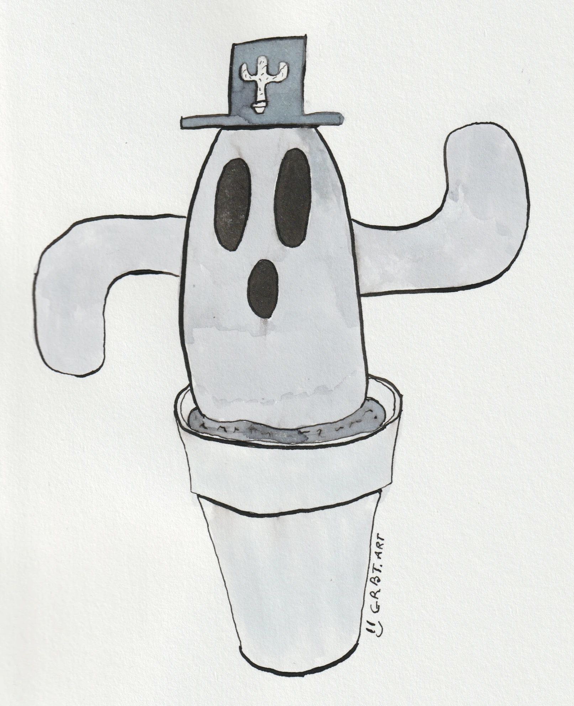 }}
{{ 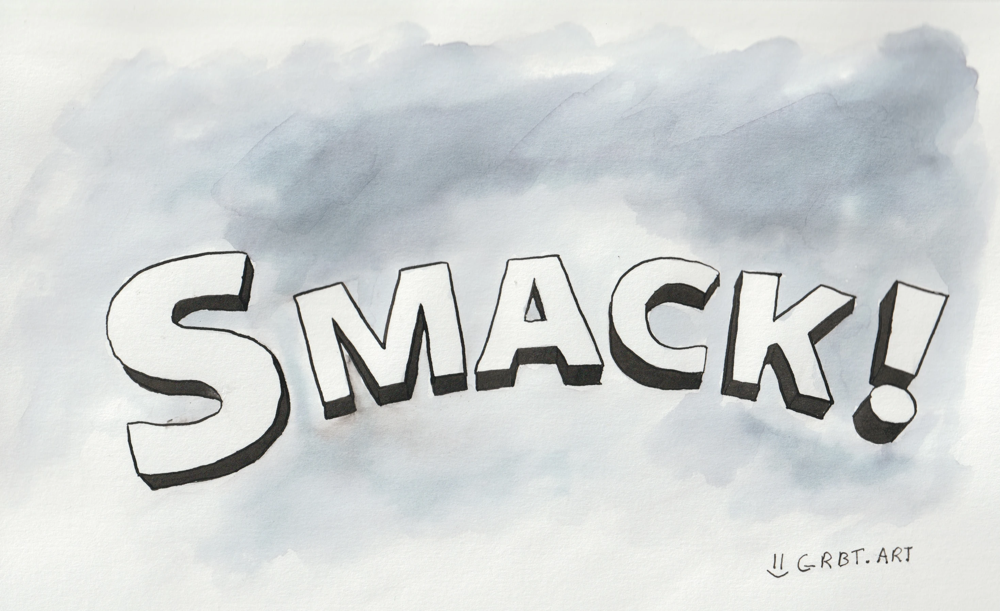 }}
{{ 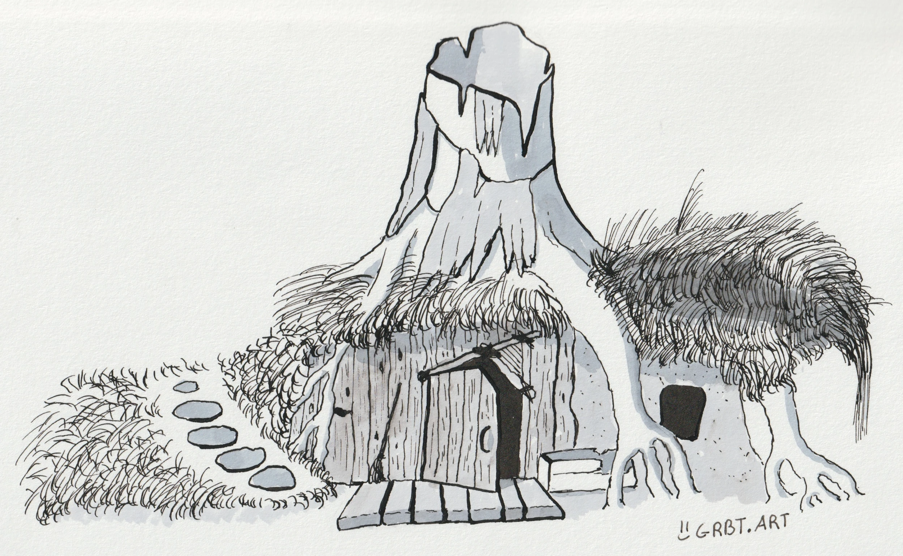 }}
{{ 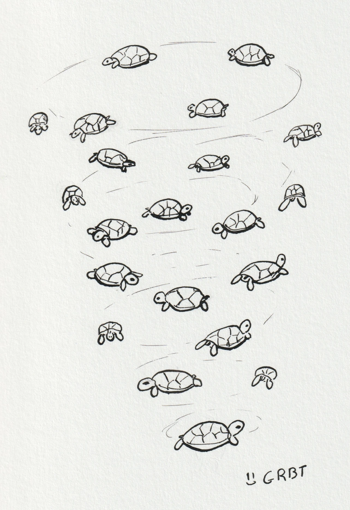 }}
{{ 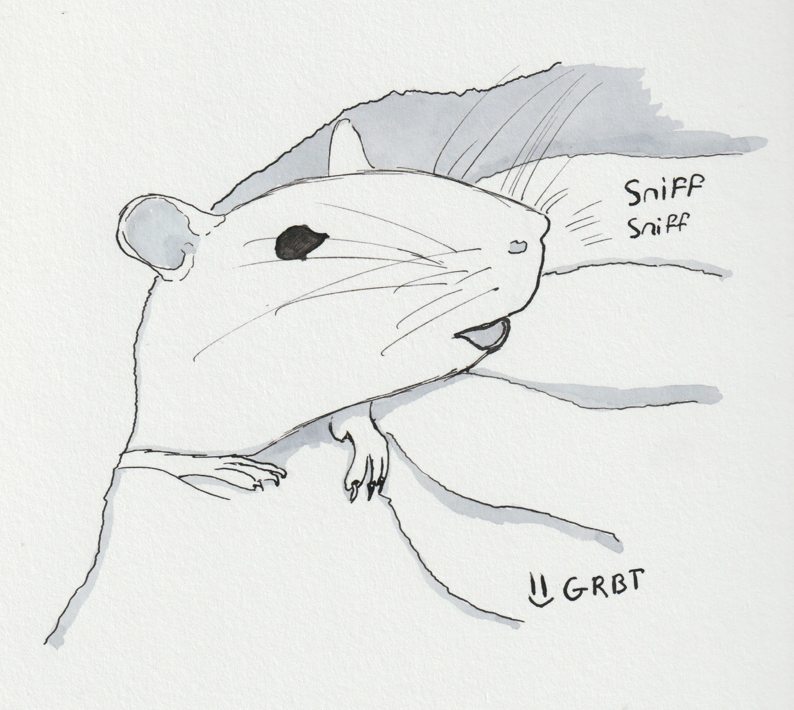 }}
{{ 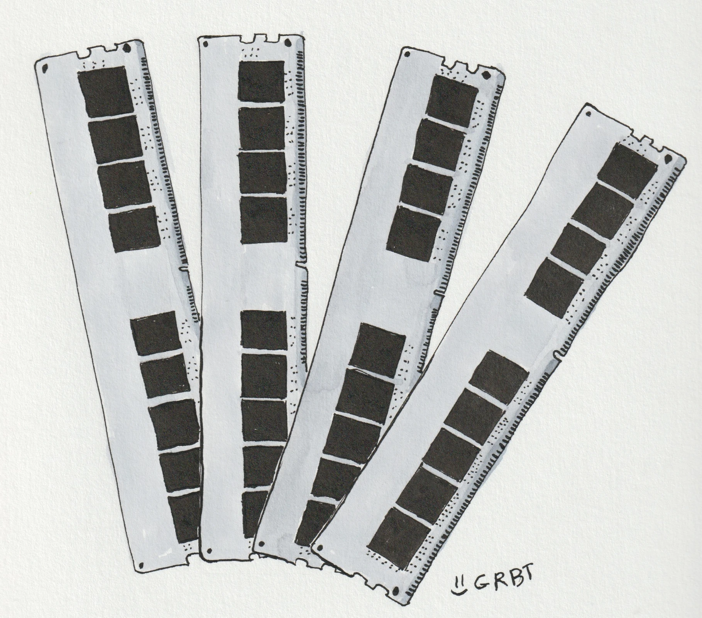 }}
{{ 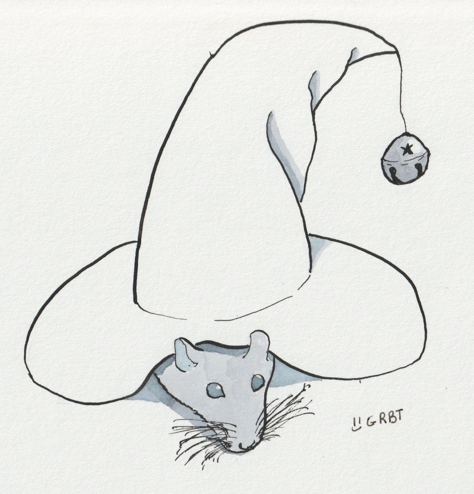 }}
{{ 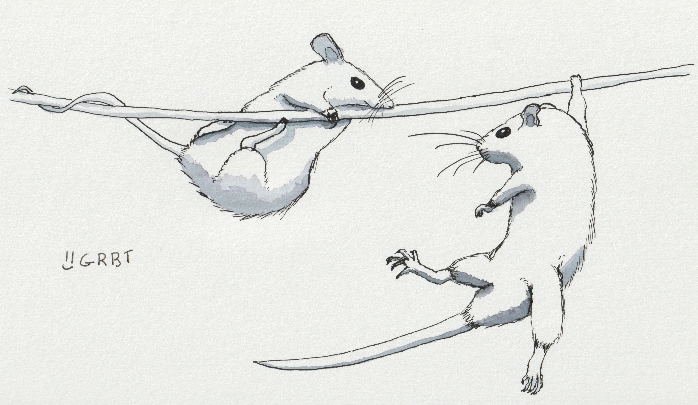 }}
